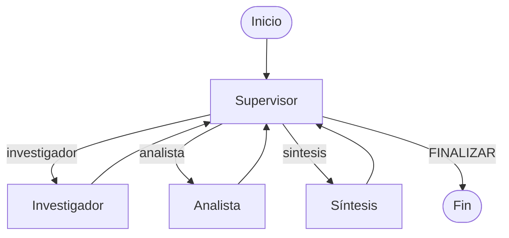

# Orquestador de análisis de ventas

Preentrega 6 de AI Engineering · Coderhouse

Orquestador multiagente que compara las ventas mensuales de dos períodos por producto. Consulta datos ficticios en SQLite, calcula las variaciones con Python y entrega un informe con referencias a los registros usados.

## Arquitectura

| Nodo | Responsabilidad |
|---|---|
| Supervisor | Decide la próxima ruta con una salida estructurada. Revisa los resultados con una rúbrica y puede pedir una corrección antes de cerrar. |
| Investigador | Interpreta los períodos y usa `consultar_ventas` para recuperar importes, unidades y fuentes desde SQLite. |
| Analista | Usa `analizar_ventas` para validar los registros y calcular diferencias y porcentajes. |
| Síntesis | Redacta el informe en español con los resultados del análisis y sus fuentes. |



La topología es jerárquica porque el Supervisor centraliza el enrutamiento y la revisión. Cada especialista devuelve su aporte al estado compartido y el control vuelve al Supervisor. El grafo ejecuta los nodos de forma asíncrona y muestra su progreso con `astream`.

`AgentState` hereda de `MessagesState` y separa investigación, análisis, instrucciones, errores e informe. Pydantic valida los artefactos. La herramienta de análisis verifica la presencia de ambos períodos por producto y rechaza duplicados. Si se rehace la investigación, se invalida el análisis anterior.

Ante una discrepancia, la rúbrica pide identificar el dato o la fuente afectada y devolver una instrucción concreta al especialista responsable. El Supervisor revisa el borrador antes de aprobarlo. Si se agotan las seis decisiones permitidas, el grafo cierra con un mensaje de revisión pendiente.

## Ejecutar en Windows

Desde la raíz del proyecto, con Python 3.12 y PowerShell:

```powershell
py -3.12 -m venv .venv
.\.venv\Scripts\Activate.ps1
python -m pip install -r requirements.txt
Copy-Item .env.example .env
```

Configurá `OPENAI_API_KEY` en el archivo `.env` y mantenelo fuera del repositorio. El proyecto configura `gpt-4o-mini` en `settings.py`.

```powershell
python setup_db.py
python main.py
```

El primer comando genera `data/ventas.db` con seis registros ficticios. El segundo ejecuta el caso de demostración. Supervisor, Investigador y Síntesis hacen llamadas al modelo. El cálculo del Analista se ejecuta localmente.

## Caso de demostración

> Compará las ventas de septiembre de 2026 como período base contra octubre de 2026 como período actual. Calculá la variación por producto y prepará un informe con conclusiones y fuentes.

| Producto | Septiembre (ARS) | Octubre (ARS) | Diferencia (ARS) | Variación |
|---|---:|---:|---:|---:|
| Cruceta GMB | 100.000 | 120.000 | +20.000 | +20 % |
| Tanza redonda | 0 | 25.000 | +25.000 | No calculable con base cero |
| Óptica Kangoo | 80.000 | 72.000 | −8.000 | −10 % |

En la ejecución verificada, el Supervisor delegó en Investigador, Analista y Síntesis, en ese orden. Revisó el borrador y eligió `FINALIZAR` en su cuarta decisión. El informe incluye dos referencias por producto, una para cada período. Por ejemplo, `ventas_mensuales|Cruceta GMB|2026-09` identifica el registro de septiembre de Cruceta GMB.

Abrí el [notebook de demostración](demo_preentrega6.ipynb) para ver la traza de delegación y el informe aprobado por el Supervisor. Podés revisarlos sin ejecutar celdas ni consumir API.

## Archivos principales

| Archivo | Contenido |
|---|---|
| `main.py` | Caso de demostración, estado inicial y salida por consola. |
| `graph.py` | Nodos, aristas y reglas de enrutamiento del grafo. |
| `state.py` | Estado compartido y modelos de datos. |
| `agents/` | Supervisor, Investigador, Analista y Síntesis. |
| `tools.py` | Consulta de ventas y cálculo de variaciones. |
| `setup_db.py` | Creación y carga de los datos de demostración. |
| `settings.py` | Carga de la configuración y creación del cliente del modelo. |
